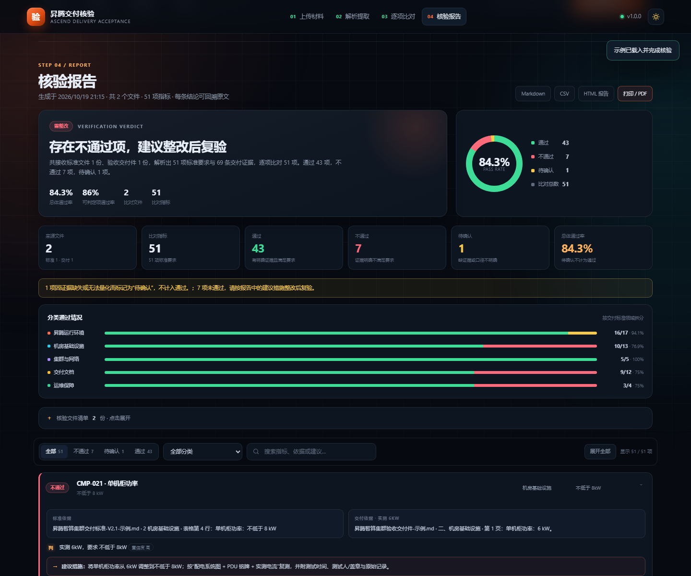

# 昇腾交付核验 · dsh-plugin-ascend-acceptance

> DeepSeek Harness（DSH）插件：上传**昇腾运行环境与机房交付标准**与**验收交付件**，自动解析结构化条款与证据、逐项比对，输出包含“通过/不通过/待确认”、标准依据、交付依据和整改建议的核验报告。

GitHub：<https://github.com/nutsDad/dsh-plugin-ascend-acceptance> · Release：`v1.0.0`



---

## 1. 它解决什么问题

昇腾算力集群验收通常同时存在两类材料：

- **标准侧**：到货验收规范、技术指标、机房基线、运维 SLA，可能是 Word、Excel、PDF 或历史 Markdown；
- **交付侧**：到货验收单、测试报告、配置清单、监控截图、机房竣工资料，格式更杂。

人工比对时最耗时、最容易漏掉的三件事是：

1. 标准条款散落在表格和段落里，没有统一的“指标”口径；
2. 交付件里的实测值需要逐条找，找到后还要判断单位、版本高低、是否真的满足；
3. 报告里写“通过/不通过”很容易，但说不清**依据是哪一条、证据在哪个文件哪一页、整改应该做什么**。

本插件把这条链路做成固定流程：

```
上传标准 + 交付件 → 解析为 blocks → 指标映射 → 逐项比对 → 可追溯报告
```

每一条结论都带：

- 标准依据：文件、章节、页码/行号、原文；
- 交付依据：文件、章节、页码/行号、证据原文；
- 判定说明与置信度；
- 不通过/待确认项的**建议措施**和复验证据要求。

---

## 2. 功能

### 2.1 双栏上传

- 标准文件、验收交付件**分别上传**，互不混用；
- 支持多选、拖拽、ZIP 包自动展开；
- 上传即解析，每份文件显示解析状态、表格/字符数、提取条数；
- 单文件上限、每类文件上限、会话有效期都可配置。

### 2.2 结构化解析

| 格式 | 支持方式 |
| --- | --- |
| `.docx` | 文档顺序、Heading 样式、段落、表格、分页符 |
| `.xlsx` | 多工作表、共享字符串、合并单元格补位、表头 |
| `.pptx` | 幻灯片页码、标题、正文、表格 |
| `.pdf` | 文本层、对象流、Flate/ASCII 编码、ToUnicode、按坐标还原行与表格 |
| `.csv` / `.tsv` | 引号、单元格内换行、分隔符自动识别 |
| `.md` / `.txt` / `.html` | 标题、段落、Markdown/HTML 表格 |
| `.json` / `.yaml` / `.yml` / `.xml` | 结构化键值拍平为可检索条目 |
| `.zip` | 解压后逐个解析内部受支持文件 |

解析器会保留 `blocks`（标题/段落/表格）和来源位置，而不是只给一段纯文本。

### 2.3 领域指标目录

内置 **78 个**昇腾交付常用指标，分 5 类：

| 分类 | 典型指标 |
| --- | --- |
| 昇腾运行环境 | NPU 型号/数量/健康/温度/功耗/显存、驱动/固件、CANN、OS、Python、PyTorch、torch_npu、vLLM、MindIE、Docker、HCCN、ECC |
| 机房基础设施 | 温湿度、机柜 U 数/功率、UPS、双路市电、PDU、接地电阻、承重、制冷、消防、漏水、门禁、PUE |
| 集群与网络 | 节点数、互联/灵衢、带宽、双上联、存储、监控、NTP、IP 规划、安全策略 |
| 交付文档 | 验收单、装箱单、出厂报告、合格证、保修卡、资产清单、拓扑图、手册、竣工图、测试报告、培训记录 |
| 运维保障 | 质保期、响应时间、备件、巡检、SLA、驻场、培训 |

每个指标定义：别名、正则、值类型（数值/版本/布尔/文本/文档存在性）、证据获取方式、整改建议。目录见 [`lib/domain/catalog.js`](lib/domain/catalog.js)。

### 2.4 逐项比对

判定类型：

- **数值**：`≥ / ≤ / > / < / = / 区间`，支持单位换算（W↔kW、GB↔TB、min↔h、Mbps↔Gbps、kg/m²↔kN/m² 等）；
- **版本**：`8.0.RC2`、`23.0.3`、`7.1.0.5.220` 按数字段 + RC/正式版等级排序；
- **布尔/状态**：正常/异常、支持/不支持、已提供/未提供；
- **文本/型号**：完全匹配或包含，支持 `/`、`、`、`或` 分隔的多个可接受值；
- **文档存在性**：按交付文件名和正文识别，明确缺失判不通过。

两条重要原则：

1. **同一指标有多份证据时，数值类取最不利值**，避免一份漂亮的汇总表掩盖现场异常；
2. **未映射到指标、或没有找到证据时，标记“待确认”而不是“通过”**，并明确标注低置信度。

### 2.5 报告

页面报告包含：

- 比对文件数、指标数；
- 通过 / 不通过 / 待确认数量与通过率；
- 分类统计、文件清单；
- **不通过项**：标准依据、交付证据、判定说明、建议措施；
- **待确认项**：缺失证据与补证建议；
- **通过项明细及依据**；
- Markdown / CSV / HTML 导出，浏览器“打印 / PDF”。

Markdown 报告适合直接贴进验收纪要；CSV 适合二次统计；HTML 报告是自包含文件，可直接归档或打印。

---

## 3. 安装

### 方式 A：从 GitHub 安装

```powershell
dsh plugin --profile web add github:nutsDad/dsh-plugin-ascend-acceptance
```

`dsh plugin` 会在 profile 目录执行 pnpm 安装；本包声明了 `dsh.bundle.patch` 与 `dsh.client`，安装后重启对应 profile 即可。

### 方式 B：从本地目录安装（开发/内网）

```powershell
$profile = "$env:DSH_HOME\profiles\desktop"
pnpm --dir $profile add file:D:\00_gongkanAgent
```

然后确认 profile 的 `package.json` 包含：

```json
{
  "dependencies": {
    "dsh-plugin-ascend-acceptance": "file:D:/00_gongkanAgent"
  },
  "dsh": {
    "profile": {
      "bundles": [
        "@deepseek-ai/dsh-base",
        "@deepseek-ai/dsh-web-app",
        "dsh-plugin-ascend-acceptance"
      ]
    }
  }
}
```

重启 DSH（桌面端退出后重新打开，或重启 `dsh web`）。启动日志会打印：

```text
ascend-acceptance: 交付核验页面位于 /ascend-acceptance/
```

### 方式 C：手工安装，不经过 pnpm

1. 在 profile 的 `node_modules` 下建立 junction：

```powershell
New-Item -ItemType Junction `
  -Path "$env:DSH_HOME\profiles\desktop\node_modules\dsh-plugin-ascend-acceptance" `
  -Target "D:\00_gongkanAgent"
```

2. 按上面的 JSON 修改 profile 的 `dependencies` 与 `dsh.profile.bundles`；
3. 重启 DSH。

### 卸载

从 `dsh.profile.bundles` 中删除 `dsh-plugin-ascend-acceptance`，删除对应依赖与 junction，重启即可。插件不写任何持久化文件。

---

## 4. 使用

1. 打开 DSH，点击会话侧边栏底部的 **「交付核验」**；
2. 或直接访问 `http://127.0.0.1:<port>/ascend-acceptance/`；
3. 左侧上传**交付标准**，右侧上传**验收交付件**；
4. 在“解析与结构化提取”中抽查条款/证据是否识别正确；
5. 点击 **开始逐项比对**；
6. 在报告页按“不通过 → 待确认 → 通过”顺序查看依据和建议；
7. 导出 Markdown/CSV/HTML 或打印 PDF。

第一次使用可以点击 **载入示例并核验**：会用内置的昇腾标准/交付件跑完整流程，得到 `43 通过 / 7 不通过 / 1 待确认` 的示例报告。

示例材料在 [`samples/`](samples/)：

- `昇腾交付标准-示例.docx` / `.pdf`
- `验收交付件-示例.xlsx`
- `交付材料包-示例.zip`

---

## 5. 配置

在 `cordis.patch.yml` 的插件行中覆盖：

```yaml
- id: ascend-acceptance
  name: dsh-plugin-ascend-acceptance
  config:
    routePrefix: /ascend-acceptance
    maxUploadBytes: 52428800          # 50 MiB
    maxFilesPerRole: 30
    maxRequirements: 800
    maxFacts: 2400
    sessionTtlMs: 7200000             # 2 小时
    maxSessions: 12
```

所有数据只在内存中；上传原始字节解析完即丢弃，不落盘、不注册后台任务。

---

## 6. API（便于集成/自动化）

| 方法 | 路径 | 说明 |
| --- | --- | --- |
| POST | `/api/sessions` | 创建核验会话 |
| GET | `/api/sessions/:id` | 会话摘要、文件、提取统计 |
| POST | `/api/sessions/:id/files?role=standard\|delivery&name=...` | 原始字节上传（`application/octet-stream`） |
| DELETE | `/api/sessions/:id/files/:fileId?role=...` | 删除文件 |
| POST | `/api/sessions/:id/sample` | 载入内置示例 |
| POST | `/api/sessions/:id/compare` | 执行比对 |
| GET | `/api/sessions/:id/extraction?role=...` | 条款/证据列表 |
| GET | `/api/sessions/:id/report` | 报告 JSON |
| GET | `/api/sessions/:id/report.md` | Markdown 报告 |
| GET | `/api/sessions/:id/report.csv` | CSV 报告 |
| GET | `/api/sessions/:id/report.html` | 自包含 HTML 报告 |
| POST | `/api/sessions/:id/reset` | 清空文件 |
| GET | `/api/health` | 版本、指标目录、限制 |
| GET | `/api/catalog` | 指标目录详情 |

示例：

```powershell
$base = 'http://127.0.0.1:19387/ascend-acceptance/api'
$session = (Invoke-RestMethod -Method Post "$base/sessions" -ContentType application/json -Body '{}').session
$id = $session.id
curl.exe -s -X POST --data-binary "@标准.docx" "$base/sessions/$id/files?role=standard&name=标准.docx"
curl.exe -s -X POST --data-binary "@交付件.xlsx" "$base/sessions/$id/files?role=delivery&name=交付件.xlsx"
Invoke-RestMethod -Method Post "$base/sessions/$id/compare" -ContentType application/json -Body '{}'
Invoke-WebRequest "$base/sessions/$id/report.md" -OutFile report.md
```

---

## 7. 架构

```
lib/
  index.js              host half：webServer 路由、上传、比对、导出
  client.js             browser half：侧边栏入口
  http.js               有界请求体、JSON/静态文件、HTML 转义
  store.js              会话、文件、提取缓存、报告
  samples.js            内置演示材料
  parse/
    index.js            格式识别与统一 blocks
    archive.js          零依赖 ZIP 读取
    docx.js             DOCX
    xlsx.js             XLSX
    pptx.js             PPTX
    pdf.js              PDF 文本层 + 坐标还原表格
    text.js             文本/CSV/Markdown/HTML
  domain/
    catalog.js          指标目录、类别、别名
    extract.js          标准条款/交付证据提取
    value.js            数值/版本/单位/布尔比较
    compare.js          逐项比对与建议
    report.js           Markdown/CSV/HTML 报告
web/
  index.html            独立核验页面
  styles.css            深/浅色主题、打印样式
  app.js                上传、预览、筛选、导出
```

插件不依赖 npm 运行时包；PDF 解析器、Office Open XML 解析、ZIP 读取都是内置实现。唯一外部可选依赖是浏览器本身。

---

## 8. 已知边界

- **扫描版/图片型 PDF** 没有文本层，无法自动 OCR；页面会提示提供可检索版或 Word/Excel 原件；
- **加密 PDF** 无法解析，会提示先解密；
- **旧版 .doc/.xls/.ppt**（OLE 二进制）不支持，请另存为 `.docx/.xlsx/.pptx`；
- PDF 表格依赖文本坐标还原；复杂合并单元格/跨页表格可能被拆行，此时会降低置信度，建议同时提供 Word/Excel；
- 条款必须能被指标目录或关键词识别；完全自定义的指标会走“其他要求”的关键词弱证据，置信度标低；
- “待确认”不是通过，需要补证或由标准方确认判定口径；
- 建议措施是规则化建议，最终整改方案仍需结合现场与厂商要求。

---

## 9. 开发与自测

```powershell
# 独立页面（无需 DSH）
node tools/dev-server.mjs 3199
# http://127.0.0.1:3199/ascend-acceptance/

# 解析/提取/比对自测
node tools/selftest.mjs

# 生成示例 DOCX/XLSX（需要 python-docx / openpyxl）
python tools/make_samples.py
```

自测覆盖：Markdown、DOCX、XLSX、PDF、版本比较、区间、文档缺失、旧版 Office 错误、SessionStore 端到端。

---

## 10. License

MIT。示例数据仅用于演示，不代表任何真实项目验收结论。
